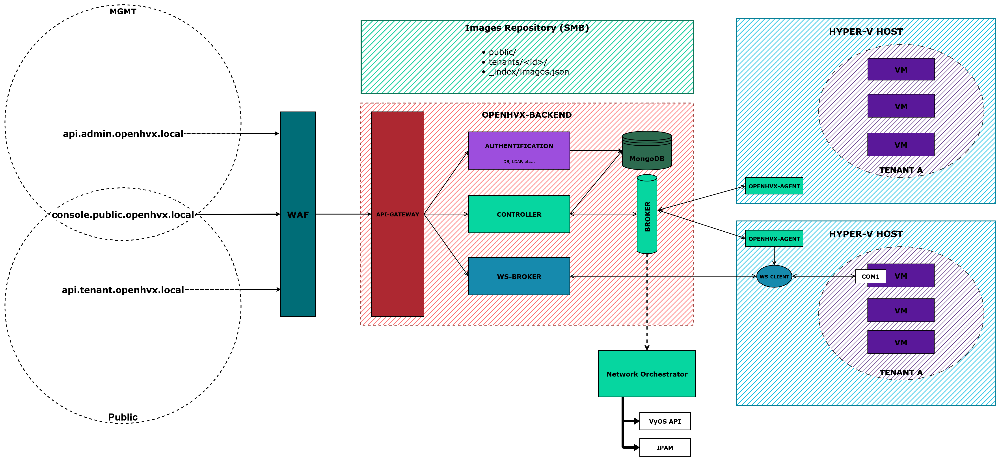
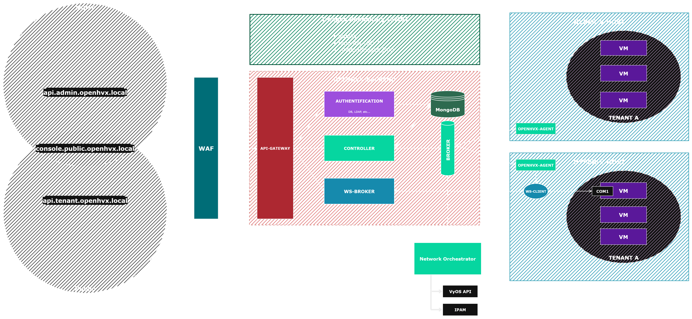

# Overview

OpenHVX is an open-source orchestration platform for **multi-tenant Hyper-V infrastructures**. It provides a unified control plane to manage virtual machines, quotas, and resources across distributed hosts, built on a lightweight and modular design.

> **Active Development Notice:** OpenHVX is under active development and not yet production-ready.
> Expect rapid iteration and potential breaking changes between releases.
> Community testing and contributions are highly encouraged!

## Architecture

OpenHVX separates orchestration and execution into clear layers.

### Architecture Diagram

 

- **Control Plane:** API Gateway, Authentication Service, Controller, WS-Broker (console tunneling), MongoDB, and RabbitMQ. It handles orchestration, multi-tenancy, quotas, and durable task admission.
- **Data Plane:** Lightweight agents on Hyper-V hosts. Agents execute tasks through PowerShell, persist a local journal, publish inventory/telemetry, and stream console sessions.

The design emphasizes **asynchronous communication**, **tenant isolation**, and **protocol v2** durability across HTTP, MongoDB, RabbitMQ, and the agent journal.

K3s is the intended deployment target. Compose remains an optional local development stack. Deployment manifests and secret distribution live in a separate deployment repository.

## Features

- **VM Lifecycle:** Create, edit, delete, and power-manage VMs with cloud-init and serial console access.
- **Quotas:** Per-tenant CPU, RAM, storage, and VM limits with atomic reservation (hold → execute → release).
- **Multi-Tenancy:** Logical separation of compute and storage resources per tenant.
- **Image catalog:** Base images come from agent/storage inventory in MongoDB - not a local controller file share index.
- **Authentication:** Admin and tenant login flows with JWT tokens, distinct audiences, and personal access tokens.
- **Agents:** Host-based agents with durable journaling and `task.protocol.v2`.
- **CLI:** `hvx` for contexts, inventory, and idempotent task submission.
- **Extensible:** Modular microservice architecture, event-driven.
- **Modern UI:** Separate surfaces for tenant and admin scopes.
- **Networking:** Automated provisioning remains future work and is not selected in the current control plane.

## User Interface

### Admin Dashboard

The admin dashboard provides a global overview of tenants, resources, and running tasks.

### Serial Console

Each VM exposes a live serial console, established as a tunnel between the **client browser** and the **Agent**, with the **WebSocket Broker** as an intermediary relay.
The broker maintains secure, tenant-scoped channels with ticketed one-time ownership so only authenticated users can attach to their own virtual machines.

This architecture provides near real-time console streaming independent of the hypervisor’s native UI or RDP, and works in headless environments.

## Roadmap

Next platform bricks: tenant networking, then VM host failover. See the
[Roadmap](/roadmap).

## Contributing

We welcome contributions from the community - documentation improvements, feature suggestions, and bug reports all help. See [How to Contribute](/contributing) or visit the [GitHub organization](https://github.com/openhvx).
